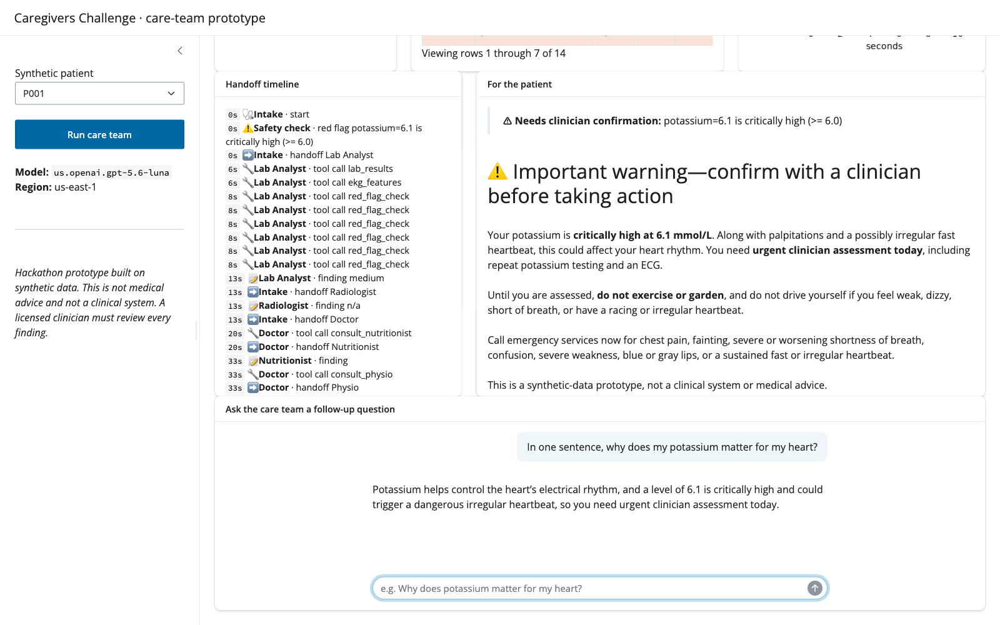

# AWS Austin Agentic AI Hackathon: Track 1 starter

Team workspace for the [Austin Agentic AI Hackathon](https://atx.rahman.dev/)
(October 23, 2026), [Track 1: Caregivers Challenge](https://atx.rahman.dev/track-1.html).

> **This is a hackathon prototype built on synthetic data. It is not a clinical
> system and not medical advice.** Say so in the demo, too.

## The track in one paragraph

Build a team of healthcare agent personas (**Lab Analyst, Radiologist, Doctor,
Nutritionist, Physio**) that read lab results, radiology images, and EKG
traces. The team then gives a patient a clear, friendly answer: what was found,
what it might mean, medicines to discuss, a food plan, and a movement plan.
Judges want to **see the handoffs**: which persona saw which input, what it
found, how sure it is, and how that became the final answer.

**Demo checklist (from the track page):** one patient scenario, at least two
specialist handoffs, and a clear patient-facing result.

## What's here



This repo has a working Python pipeline that already meets the demo checklist,
a Shiny app to show it, an R version, and an AgentCore wrapper. Everything runs
on **Amazon Bedrock** through [chatlas](https://posit-dev.github.io/chatlas/)
(Python) and [ellmer](https://ellmer.tidyverse.org/) (R).

```
intake ─┬─ labs + EKG ─> Lab Analyst  (tools: lab_results, ekg_features, red_flag_check)
        └─ image ──────> Radiologist  (vision; skipped with a note if no image)
                              │
                              v
                           Doctor ──> consult_nutritionist ─> Nutritionist
                              │   └─> consult_physio ───────> Physio
                              v
                  patient-facing summary + provenance table + disclaimer
```

| Path | What it is |
|---|---|
| [`IDEAS.md`](IDEAS.md) | Project ideas, our best bets, team split, and timeline for the day |
| [`POSITRON.md`](POSITRON.md) | Using Positron on SageMaker at the event, and Positron Desktop afterwards |
| [`caregivers/`](caregivers/) | Personas, deterministic tools, orchestrator, and the JSONL audit log |
| [`app/app.py`](app/app.py) | Shiny for Python demo app with a live handoff timeline and follow-up chat |
| [`data/generate_synthetic.py`](data/generate_synthetic.py) | Generates synthetic patients: a labs CSV, a 10 s EKG CSV at 250 Hz, and a profile JSON |
| [`data/sample/`](data/sample/) | Two generated patients: P001 (high potassium, irregular fast rhythm) and P002 (healthy runner) |
| [`logs/example-run.jsonl`](logs/example-run.jsonl), [`logs/example-summary.md`](logs/example-summary.md) | Output from a real run on P001 |
| [`r/caregivers.R`](r/caregivers.R) | The same pattern in R with ellmer (Lab Analyst → Doctor → Nutritionist) |
| [`agentcore/`](agentcore/) | The care team as an Amazon Bedrock AgentCore Runtime |
| [`scripts/smoke_test.py`](scripts/smoke_test.py) | Checks your AWS identity and makes one Bedrock call |

## Quickstart

You need [uv](https://docs.astral.sh/uv/) and AWS credentials that can call
Bedrock in `us-east-1`. Inside Positron on SageMaker, the Space's execution
role already provides these credentials.

```bash
uv sync
uv run python scripts/smoke_test.py               # expect "Response: OK"
uv run python -m caregivers.orchestrator P001     # about 1 minute; prints the handoff timeline
uv run shiny run app/app.py                       # or open app/app.py in Positron and click Run App
```

The Radiologist is optional. To turn it on, add a public chest X-ray as
`data/raw/P001_cxr.png`, or pass `--image path/to/file.png`. One source is
[NIH ChestX-ray14](https://www.kaggle.com/datasets/nih-chest-xrays/data).

### Choose a model

Set `BEDROCK_MODEL_ID`. The default is the event kit's
`us.openai.gpt-5.6-luna`. The kit also tests `us.openai.gpt-5.4`,
`us.openai.gpt-5.5`, `us.openai.gpt-5.6-sol`, and `us.openai.gpt-5.6-terra`.
Claude profiles, such as `us.anthropic.claude-sonnet-5-5`, also work if your
account allows them. To list the profiles you can use:

```bash
aws bedrock list-inference-profiles --region us-east-1 --query 'inferenceProfileSummaries[].inferenceProfileId'
```

> **chatlas tip:** When you use a `us.*` inference profile ID, pass
> `api="converse"` to `ChatBedrock()`. Otherwise, chatlas sends GPT models to
> the bedrock-mantle endpoint, which returns a 404 for that ID.
> [`caregivers/config.py`](caregivers/config.py) already does this.

### R

```bash
AWS_REGION=us-east-1 Rscript r/caregivers.R
```

The R script needs `ellmer` 0.5 or later and `jsonlite`. Its tools return JSON
strings, because ellmer 0.5 deprecates tools that return plain R lists. It uses
the same persona pattern: a Lab Analyst with tools, and a Doctor that calls a
Nutritionist agent *as a tool*.

## Guardrails (from the track brief)

- **Synthetic or public data only.** Keep inputs de-identified, and send no
  PHI to unapproved endpoints.
  [MIMIC-CXR-JPG](https://physionet.org/) requires PhysioNet credentialing.
- **Red flags need a human.** `caregivers/tools.py` runs a code-side
  critical-value check (for example, potassium ≥ 6.0 or SpO₂ < 90%) that
  doesn't depend on the model. When it finds one, the summary opens with
  "Needs clinician confirmation" and marks medicines as pending clinician
  review.
- **Fail safely.** If a specialist call fails or an input is missing, the
  pipeline logs the problem and asks for a clinical re-evaluation instead of
  crashing.
- **Audit everything.** Every handoff, tool call, finding, red flag, and error
  goes to `logs/<patient>-<timestamp>.jsonl`.
- **Watch costs.** AgentCore runtimes and model calls cost money. Clean up when
  you finish.

## Event resources

- Track page: <https://atx.rahman.dev/track-1.html>
- Event starter kit (a Bedrock Converse check and an AgentCore deploy): <https://atx.rahman.dev/hackathon-kit.zip>
- Positron on SageMaker setup script: <https://atx.rahman.dev/setup_positron_sagemaker_from_private_ecr.py>
- Login walkthrough: <https://atx.rahman.dev/hackathon-login.mp4>
- Datasets: [MultiCaRe](https://www.kaggle.com/datasets/mauronievasoffidani/multicare),
  [PathVQA](https://huggingface.co/datasets/flant5/pathvqa),
  [NIH ChestX-ray14](https://www.kaggle.com/datasets/nih-chest-xrays/data), and
  [MIMIC-CXR-JPG](https://physionet.org/)
- Sample repos: [aws-samples/sample-healthcare-agents](https://github.com/aws-samples/sample-healthcare-agents),
  [aws-samples/sample-agentic-radmapper](https://github.com/aws-samples/sample-agentic-radmapper),
  [aws-samples/amazon-bedrock-agents-healthcare-lifesciences](https://github.com/aws-samples/amazon-bedrock-agents-healthcare-lifesciences), and
  [MedAgent-Pro](https://github.com/jinlab-imvr/MedAgent-Pro)
- Tools: [Positron](https://positron.posit.co/), [chatlas](https://posit-dev.github.io/chatlas/),
  [ellmer](https://ellmer.tidyverse.org/), [Shiny for Python](https://shiny.posit.co/py/), and
  [shinychat](https://posit-dev.github.io/shinychat/)
